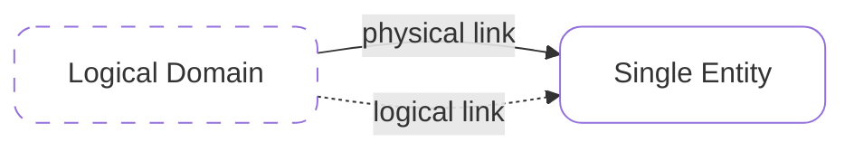
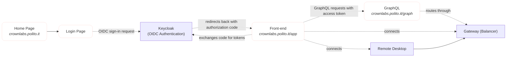
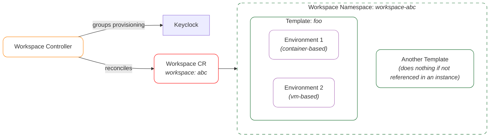
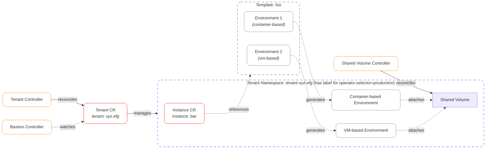
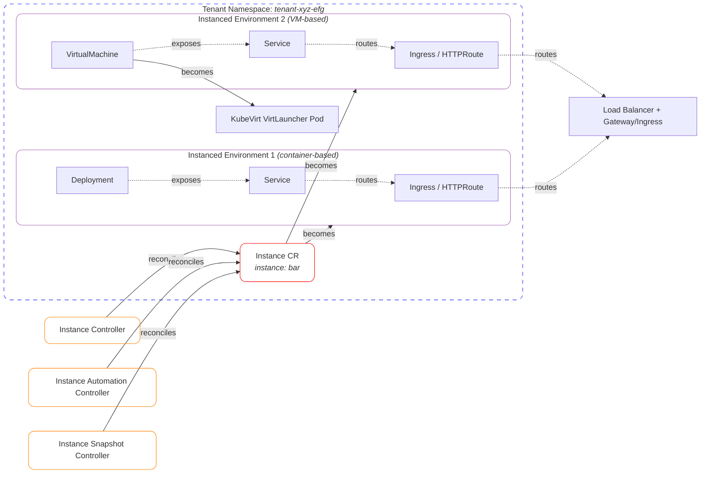

### Mermaid Legend:

## Frontend Logic
The following will be placed in **home/frontend-app**

## Workspace Business Logic
The following will be placed in **home/operators/operator/workspace**

## Tenant Business Logic
The following will be placed in **home/operators/operator/tenant**

## Instances Deep Dive
The following will be placed in **home/operators/.../instctl**

