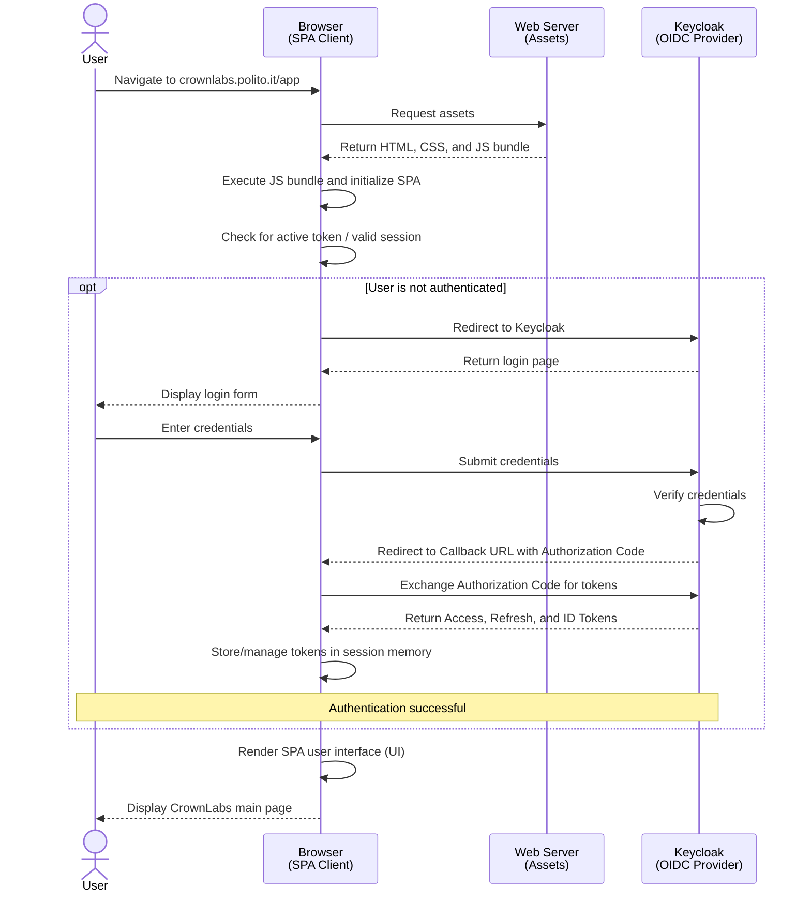
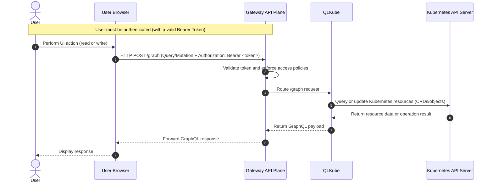
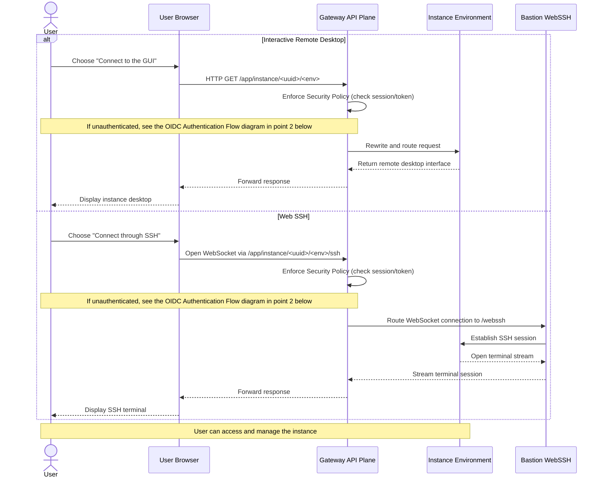
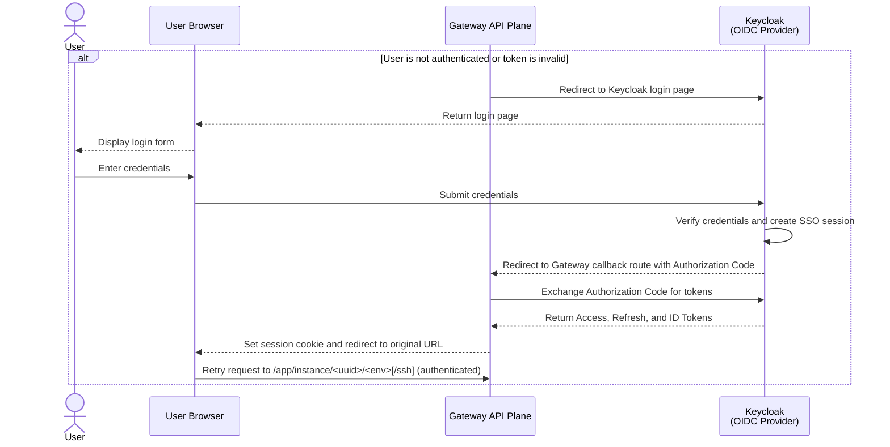

# CrownLabs frontend

This file describes the structure and general coding guidelines of the CrownLabs frontend.

## Frontend Logic

This section describes the client-side behavior of the CrownLabs interactions. It handles authentication via **Keycloak** (OpenID Connect) and use **QLKube** to interact with the Kubernetes resources.

### Scenario 1: SPA Loading and Authentication (Login)

CrownLabs is a **Single Page Application (SPA)**: after loading the initial assets, the JavaScript code runs in the user's browser and detects whether the user is already authenticated or not, triggering the OIDC authentication procedure with **Keycloak** if a valid session or active token is missing.

Main Interacting Elements:
* **Browser:** The user browser executes the SPA's JavaScript code, managing state, routing, and rendering.
* **Web Server:** Delivers the static frontend application files.
* **Keycloak:** Acts as the *Identity & Authorization Server*, handling login, SSO sessions, and JWT token issuance.



### Scenario 2: GraphQL Operations (Queries and Mutations)

Describes how the User can reads or modifies the state of **Kubernetes** resources via the GraphQL endpoint. Every action request carries the `Bearer Token` to enable identity validation and permission checks across the chain, therefore the User must be already authenticate.

**Note**: Access the GraphQL playground at `crownlabs.polito.it/graph`.

Main Interacting Elements:
* **QLKube:** GraphQL layer that translates frontend queries and *mutations* into operations on Kubernetes resources.
* **Kubernetes API Server:** Core cluster component that exposes and persists the state of Kubernetes resources.
* **Gateway API Plane:** Entry point for the traffic; enforces *Security Policies* and routes traffic.



### Scenario 3: Accessing a Remote Instance

CrownLabs frontend provides **two main ways** to access an instance:

- **Interactive Remote Desktop (`/app/instance/<uuid>/<env>`):** the browser opens the graphical environment, such as VS Code or the distro's GNOME desktop.
- **Web SSH (`/app/instance/<uuid>/<env>/ssh`):** the browser opens a WebSocket connection routed to the `/webssh` gateway endpoint; the Bastion service then establishes SSH access to the selected instance.

Main Interconnecting Elements:
- **Gateway API Data Plane:** Entry point for the traffic; enforces *Security Policies* and routes traffic.
- **Keycloak:** Acts as the *Identity & Authorization Server*, handling login, SSO sessions, and JWT token issuance.
- **Instance Environment:** The virtual environment that exposes the remote desktop or SSH target.
- **Bastion WebSSH:** Intermediary service that establishes the SSH session to the target instance.

#### 1. Instance Access Modes

Illustrates the traffic routing through the **Gateway API Plane** for both access modes once the user is authenticated.



#### 2. OIDC Authentication Flow (Unauthenticated Access)

Describes the steps performed by the **Gateway API Plane** and **Keycloak** when an unauthenticated user attempts to access either `/app/instance/<uuid>/<env>` or `/app/instance/<uuid>/<env>/ssh` (described on point 1 above).



## Setup

Before starting set the necessary environment variables either using a `.env` file (preferred on windows) or by defining them on your local machine. To setup the repo, use the following commands.

```bash
# install necessary packages
npm install

# To run the app locally
npm start

# To build the app locally
npm build-app

```

After the setup is complete, if you start the app locally and see the apiserver url on the home page everything is working fine.

## Structure

Our frontend is a [React](https://it.reactjs.org/) application. We use [antd](https://ant.design/) as the main component library and [Tailwind](https://tailwindcss.com/) utilities to handle specific css scenarios (padding and margin). We chose to use [Typescript](https://www.typescriptlang.org/) to have a bettere development experience.

The application is made to be deployed using docker and can be hosted on a custom subroute. The application takes some environment variables, each needs to have the `REACT_APP_CROWNLABS` prefix. In order to define environment variables at container run-time they need to be defined on the `window` object in the `public/config.js` file.


## CI checks

We use ESLint to enforce linting and code quality. We use Prettier to have a uniform code style. These checks are enforced by a GitHub Action run on PRs. Also locally a pre-commit hook written with [husky](https://typicode.github.io/husky/#/) uses [lint-staged](https://github.com/okonet/lint-staged) to format and check files in the staging area before each commit.

Be sure to add the following to `~/.config/husky/init.sh` if you're using `nvm` (which is strongly advised)

```sh
export NVM_DIR="$HOME/.nvm"
[ -s "$NVM_DIR/nvm.sh" ] && \. "$NVM_DIR/nvm.sh"
```

## Guidelines

We define some coding guidelines to ease the collaboration in our team and to ease the review process.

### Dir structure

The components are in `src/components`. The folder has subdirs, one for each page of the app, plus `misc` for the miscellaneous UI elements (those common between all components) and a `util` dir for custom UI elements used multiple times across the code (custom dialogs, inputs, etc...).

Each component needs to have its own folder with the following structure, e.g. for an `Example` component:

- `Example.tsx` - component definition
- `Exmaple.css` - css specific code for component
- `index.ts` - utility file to shorten component import statement in other files

#### Component

Each component file needs to host a single component and needs to have the following structure:

- import declarations (when you can use non-default imports use them to reduce bundle size)
- general constant declarations for the components (if needed)
- component props interface with the name `${ComponentName}Props` (if needed)
- functional component declaration

Additionally:

- if a task (like manipulating dynamic elements, animations, resizing) can be **_easily_** implemented using tailwind/css follow that implementation instead of relying on React/TS
- have jsx only inside the return statement of the component

  - Invalid:

  ```ts
  const Example: FC<IExampleProps> = ({ ...props }) => {
    const { text, disabled, onClick, size, specialCSS } = props;
    // do not have jsx outside the return
    const content = <h5 className={specialCSS ? 'rainbow-text' : ''}>{text}</h5>

    return (
    <Button
        disabled={disabled}
        size={size}
        onClick={onClick}
        type="primary"
        className="p-10"
    >
        {content}
    </Button>
  );
  ```

  - Accepted:

  ```tsx
  const Example: FC<IExampleProps> = ({ ...props }) => {
    const { text, disabled, onClick, size, specialCSS } = props;

    return (
    <Button
        disabled={disabled}
        size={size}
        onClick={onClick}
        type="primary"
        className="p-10"
    >
        <h5 className={specialCSS ? 'rainbow-text' : ''}>{text}</h5>
    </Button>
  );
  ```

## Environment IP Resolution & SSH Access

Instance IP addresses and SSH access instructions are handled through a joint backend-frontend workflow:

### Backend IP Resolution
1. **IP Field Population**: The Instance Operator resolves the internal VMI or container Pod IP address (`GetEnvironmentResolvedIP`) and populates the `ip` field under `status.environments[]` in the `Instance` Custom Resource status.

### Frontend SSH Command Generation
1. **Direct SSH Connection**: In the SSH modal (`SSHModalContent`), the frontend reads `env.ip` and dynamically constructs the copyable SSH command:
   ```bash
   ssh -J bastion@${VITE_APP_CROWNLABS_BASTION_HOST} crownlabs@${env.ip}
   ```
2. **WebSSH Connection**: For in-browser SSH sessions, the frontend builds the URL `/instance/${namespace}/${name}/${envName}/ssh`, launching the WebSSH terminal component (`SSHTerminal`) which connects via WebSockets to the Bastion service exposed on `/webssh`.

## Useful links

- [Useful answer for deploying react app on subroute](https://stackoverflow.com/questions/49429906/how-should-i-configure-create-react-app-to-serve-app-from-subdirectory/58508562#58508562)
